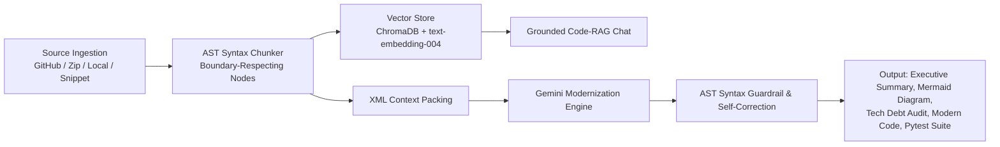

# 🔍 LegacyLens AI: Codebase Modernization & Documentation Engine

[](https://www.python.org/)
[](https://streamlit.io/)
[](https://www.trychroma.com/)
[](https://ai.google.dev/)
[](LICENSE)

**LegacyLens AI** is an intelligent, end-to-end modernization engine designed to ingest legacy, undocumented, or messy codebases, analyze their semantic architecture using AST (Abstract Syntax Tree) decomposition, index them with ChromaDB for grounded RAG, and modernize them into production-ready, PEP-8 compliant code with interactive Mermaid.js diagrams, security debt audits, and runnable `pytest` suites.

---

## 🌟 Key Highlights & Architecture

LegacyLens AI runs on a disciplined **4-Stage Pipeline**:



### 1. Stage 1: Noise-Filtered Source Ingestion (`pipeline/ingestor.py`)
- Ingests from **GitHub URLs**, **Zip archives**, **local filesystem directories**, or **raw code snippets**.
- Strict pruning of non-code artifacts (`.git`, `node_modules`, `venv`, `__pycache__`, `dist`, `.chroma_db`, etc.).
- Binary and non-code file exclusion (`.png`, `.jpg`, `.pyc`, `.wasm`, `.lock`, etc.).
- Computes SHA-256 fingerprints to eliminate duplicate files and ensure traceability.

### 2. Stage 2: AST-Based Semantic Chunker (`pipeline/ast_chunker.py`)
- Deconstructs codebases into discrete, syntax-aware AST chunks (`function`, `class`, `module_globals`).
- Preserves node start/end line bounds, parent classes, import headers, and docstrings.
- Includes a robust regex fallback chunker for non-Python or syntactically broken legacy files.
- Provides token-aware XML context packing (`<codebase>`, `<file>`, `<chunk>`) optimized for long-context LLM reasoning.

### 3. Stage 3: Grounded Code-RAG Vector Store (`engine/rag_store.py`)
- Embeds AST chunks using `text-embedding-004` (with fallback hashing for offline test environments).
- Indexes vectors into a local, persistent **ChromaDB** store (`.chroma_db/`).
- Performs semantic retrieval with exact filename, line-number citations, and cosine similarity rankings.
- Grounded contextual chat prevents hallucinations by anchoring answers to source chunks.

### 4. Stage 4: Long-Context Modernizer with AST Guardrail (`engine/modernizer.py`)
- Powered by `gemini-2.5-pro` / `gemini-2.5-flash` with structured Pydantic schema validation (`CodeModernizationOutput`).
- Generates:
  - 📋 **Executive Summary**: High-level explanation of business logic and architecture.
  - 📊 **Mermaid.js Flowchart**: Dynamic architecture diagram showing call flows and component dependencies.
  - ⚠️ **Tech Debt & Risk Audit**: Pinpoints security risks (hardcoded credentials, SQL injections), anti-patterns, and bottlenecks.
  - 🐍 **Modernized Code**: Refactored with strict PEP-8 standards, type annotations, and Google-style docstrings.
  - 🧪 **Pytest Suite**: Complete, runnable unit tests covering happy paths, edge cases, and error handling.
- **AST Guardrail with 1-Step Self-Correction**: Validates generated code using Python's AST parser. If any syntax error is detected, an automated reflection prompt corrects the code before presenting it to the user.

---

## 🖥️ Interactive Web UI (Streamlit)

LegacyLens AI features a rich, glassmorphic Streamlit application (`app.py`) organized across 5 tabs:

1. **Architecture & Modernization**: View side-by-side legacy vs. modernized code diffs, executive summary, and copyable refactored code.
2. **Mermaid Diagram**: Live-rendered interactive Mermaid.js architecture flowchart.
3. **Tech Debt & Risks**: Categorized security, performance, and maintenance risk cards with line references.
4. **Pytest Suite**: Complete test suite with 1-click execution inside the web UI.
5. **AST Inspector & RAG Chat**: Explore individual parsed AST nodes, metadata, and converse with the grounded Code-RAG assistant.

---

## 📁 Repository Structure

```text
LegacyLens AI/
├── app.py                   # Full-featured Streamlit interactive web interface
├── main.py                  # CLI entry point (modes: engine, pipeline, web)
├── requirements.txt         # Core dependencies
├── sample_legacy_code.py    # Python legacy code sample for testing & demonstrations
├── test_pipeline.py         # Pytest test suite validating ingestion, AST, RAG, and UI
│
├── pipeline/
│   ├── __init__.py          # Pipeline module entry point & CLI demo
│   ├── ingestor.py          # Stage 1: File, directory, zip, and Git repository ingestion
│   └── ast_chunker.py       # Stage 2: AST decomposition & XML context serialization
│
├── engine/
│   ├── __init__.py          # Engine module entry point & CLI demo
│   ├── __main__.py          # Direct execution launcher for the engine
│   ├── rag_store.py         # Stage 3: ChromaDB vector storage and semantic retrieval
│   └── modernizer.py        # Stage 4: Gemini modernization engine with AST guardrails
│
└── .chroma_db/              # Persistent ChromaDB vector index directory
```

---

## 🚀 Quick Start

### 1. Prerequisites
- Python 3.10+
- Google Gemini API Key (get one from [Google AI Studio](https://aistudio.google.com/))

### 2. Environment Setup

```bash
# Clone or navigate into the repository
cd "d:/ANTIGRAVITY/DL_project/LegacyLens AI"

# Create and activate a virtual environment
python -m venv .venv
# On Windows:
.venv\Scripts\activate
# On Linux / macOS:
# source .venv/bin/activate

# Install required dependencies
pip install -r requirements.txt
```

### 3. Set Up API Key

Set your Google Gemini API key as an environment variable:

```bash
# Windows PowerShell
$env:GEMINI_API_KEY="your-gemini-api-key"

# Windows CMD
set GEMINI_API_KEY="your-gemini-api-key"

# Linux / macOS
export GEMINI_API_KEY="your-gemini-api-key"
```

*(Note: You can also enter your API key directly inside the Streamlit sidebar settings).*

---

## 🕹️ Running the Application

### Option A: Interactive Web UI (Recommended)
```bash
streamlit run app.py
```
Or via `main.py`:
```bash
python main.py --mode web
```
Open [http://localhost:8501](http://localhost:8501) in your browser.

### Option B: CLI Engine Demo
Runs an end-to-end ingestion, AST chunking, ChromaDB indexing, and modernization against `sample_legacy_code.py`:
```bash
python main.py --mode engine
```

### Option C: Pipeline Ingestion Demo
Runs Stages 1 and 2 (Ingestion and AST chunking):
```bash
python main.py --mode pipeline
```

---

## 🧪 Running Tests

To verify the integrity of the ingestion pipeline, AST chunker, and vector store:

```bash
pytest test_pipeline.py -v
```

---

## 🛡️ AST Guardrail & Self-Correction

LegacyLens AI guarantees that generated Python code is syntactically sound. The modernization pipeline incorporates `validate_python_syntax(code_str)`:

```python
# Validation flow in engine/modernizer.py
is_valid, err_msg, err_line = validate_python_syntax(modernized_code)
if not is_valid:
    # Triggers automatic 1-step self-correction with error feedback to Gemini
    corrected_code = retry_modernization_with_error(modernized_code, err_msg, err_line)
```

---

## 📄 License

This project is licensed under the [MIT License](LICENSE).
